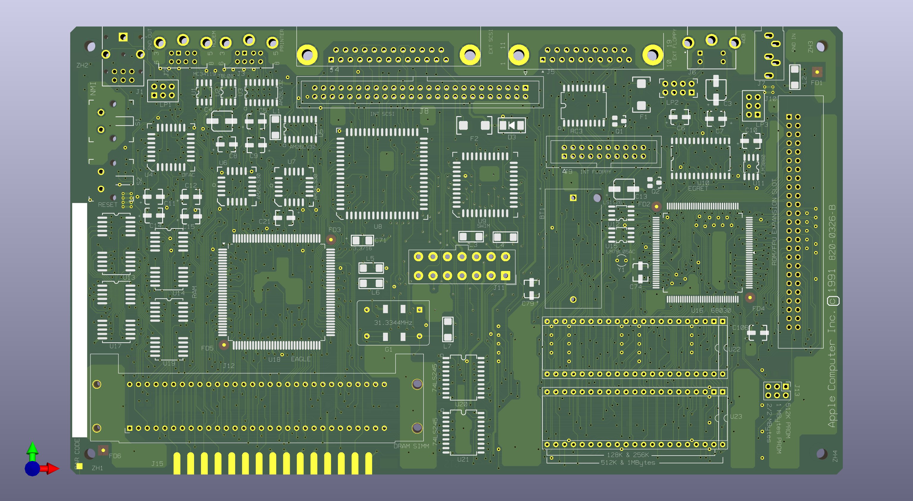

# Classic II

Reproduction of Macintosh Classic II

This was reverse-engineered from a later-revision Classic II logic board. All components on the front side, and a handful of components on the back side, were removed, and the board was scanned.

Since my scanner isn't very accurate, scale-wise, the scans were resized and aligned to match the board's measurements.

The board was severely damaged by battery and capacitor leakage, but I was able to faithfully reproduce all connections.

The inner layers are used for various ground and power planes - you can make out a surprising amount of inner detail by backlighting the board and seeing what shines through the windows left by vias, etc., so these are also reproduced fairly accurately.

The [Bomarc schematics](documents/Bomarc%20schematics%20-%20corrected.pdf) for this board were useful as a reference, but they are for the earlier revision, and they do contain some inaccuracies.

## Issues

It's likely some of the signals of the undocumented Apple ASICs in [my schematic](ClassicIIRevB/ClassicIIRevB.pdf) aren't classified correctly.

The silkscreen markings of the PCB aren't as nice as I'd like yet.

## Reloaded

If you want to build one of these, you might find it easier to use the "Reloaded" version [here](./ClassicIIReloaded/).
